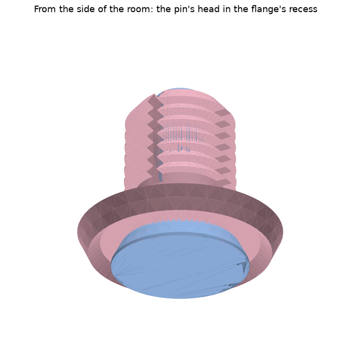
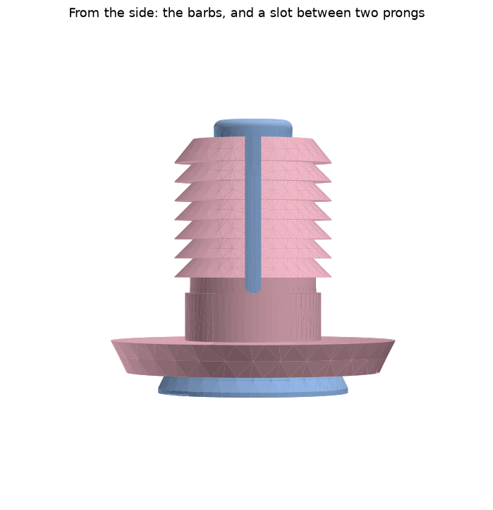

# bekant-net-holder

A holder for the IKEA Bekant's cable net, in place of IKEA's part 130884. A plug with barbs goes
into a hole under the desk, and its flange holds a loop of the net. A pin goes into the plug and
keeps its prongs apart, so the barbs stay in the hole.






## Parts

| Printed | Count | Prints | Supports |
| --- | --- | --- | --- |
| `plug` | 1 | Standing on its flange's rim, prongs up | Under the recess's floor, from the plate only |
| `pin` | 1 | Standing on its head, shaft up | None |

The hole under the desk is 9 mm across. The plug's flange is 18 mm across against the desk and
16 mm at its rim, 2 mm thick. Inside the rim is a recess 1 mm deep, 14 mm across at its floor,
which the pin's head sits in. The shaft is 12.7 mm long: an 8.6 mm collar, 3 mm high, which
slides into the desk's hole with 0.2 mm on either side, an 8 mm neck, 1 mm high, and seven barbs.
Each barb is 10 mm across at its flat face, which faces the flange, and narrows away from it. The
barbs are wider than the desk's hole: the prongs bend in to pass it, and the barbs catch behind
it. Two slots, 1 mm wide, cross the shaft from the collar to its end and split it into four
prongs. The wall of a prong is 1.3 mm at its thinnest, between two barbs.

The pin's head is 12 mm across and 2.3 mm thick. Its shaft is 14.9 mm long and ends 1.2 mm past
the prongs. It is 4.75 mm across for 11.3 mm from the head, then widens to 4.98 mm next to its
round end. Where it meets the head it rounds out with a radius of 0.75 mm.

The hole through the plug follows the pin: the pin's shaft and the `printed_grip` fit from
`printers.toml` on either side, 4.85 mm on the P2S in PLA, widening with the pin toward the
prongs' end. The pin pushes in firmly and holds, so it does not fall out under the desk. Its wide
end bends the prongs apart on its way through the straight length. The hole's edge in the recess
is cut away at 45°, so it clears the round at the pin's head.

The plug prints standing, since it is round. Its layers lie across the prongs, which bend in on
their way into the desk. The recess's floor hangs 1 mm over the plate and prints
on supports that stand on the plate (`enable_support`, `support_on_build_plate_only`). The barbs'
flat faces are ledges of 1.2 mm and print without supports.

The pin prints standing on its head. Its shaft only fills the hole and takes no bending. It
widens by 0.1 mm a side over 3.1 mm, which prints without supports.

## Putting it together

1. Push the plug into the hole under the desk until the flange lies against the desk.
2. Hang the net's loop over the flange.
3. Push the pin into the plug's hole until its head lies in the recess.

To take it out, pull the pin by its head, then pull the plug.

## Printing

```sh
bin/part bekant-net-holder --open
```


