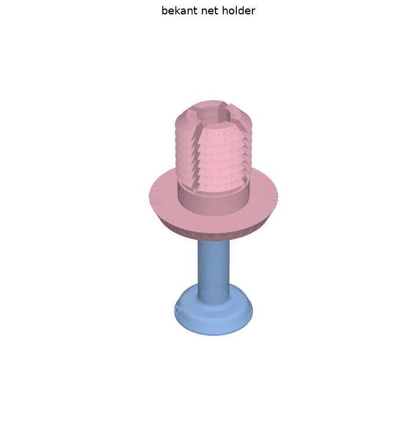
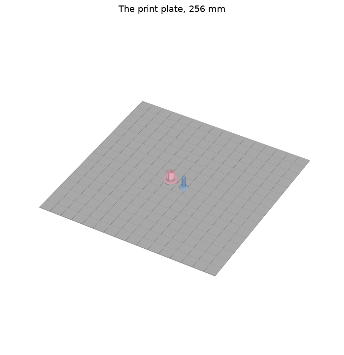

# bekant-net-holder

A holder for the IKEA Bekant's cable net, in place of IKEA's part 130884. A plug with barbs goes
into a hole under the desk, and its flange holds a loop of the net. A pin goes into the plug and
pushes its prongs apart, so the barbs press into the hole's wall.




## Parts

| Printed | Count | Prints | Supports |
| --- | --- | --- | --- |
| `plug` | 1 | Standing on its flange's rim, prongs up | Under the recess's floor, from the plate only |
| `pin` | 1 | Standing on its head, shaft up | None |

The plug's shape is measured on a model of the holder, `ikea130884 v2.stl`, and made 10/9 as big.
The model's flange is 18 mm across and its collar 9.5 mm. On a holder on the desk they measure
20 mm and 10.55 mm.

The plug's flange is 19 mm across against the desk and 16.8 mm at its rim, 2.2 mm thick. Inside
the rim is a recess 1.1 mm deep, 14.6 mm across at its floor, which the pin's head sits in. The
flange and the recess are 1 mm smaller across than the model's made 10/9 as big. The
shaft is 14.1 mm long: a 10.6 mm collar, 3.3 mm high, a 9.8 mm neck, 1.1 mm high, and seven barbs.
Each barb is 11.1 mm across at its flat face, which faces the flange, and narrows away from it.
Two slots, 1.1 mm wide, cross the shaft from the collar to its end and split it into four prongs.
The wall of a prong is 1.5 mm at its thinnest, between two barbs.

The pin's sizes are measured on a model of it, `Ikea Bekant Cable Holder Pin.stl`. Its head is
12 mm across and 2.3 mm thick. Its shaft is 14.9 mm long and ends 0.3 mm short of the prongs' end.
It is 4.75 mm across for 11.3 mm from the head, then widens to 4.98 mm next to its round end.
Where it meets the head it rounds out with a radius of 0.75 mm.

The hole through the plug is 5.4 mm from the recess to 5 mm before the prongs' end: the pin's wide
end slides through with 0.2 mm on either side. There the hole narrows at 45° to the pin's shaft
with the `printed_grip` fit from `printers.toml` on either side, 4.85 mm on the P2S in PLA. The
pin's wide end is 0.13 mm wider than that hole. It comes to rest in it, pushes the prongs apart
and is held by them. The prongs are 5.8 mm long where the hole narrows, so they bend for it. The
hole's edge in the recess is cut away at 45°, so it clears the round at the pin's head.

The plug prints standing, since it is round. Its layers lie across the prongs, which bend in on
their way into the desk. The recess's floor hangs 1.1 mm over the plate and prints
on supports that stand on the plate (`enable_support`, `support_on_build_plate_only`). The barbs'
flat faces are ledges of 1.3 mm and print without supports.

The pin prints standing on its head. Its shaft only keeps the prongs apart and takes no bending. It
widens by 0.1 mm a side over 3.1 mm, which prints without supports.

The pictures show the pin out of the plug, under its hole.

## Putting it together

1. Push the plug into the hole under the desk until the flange lies against the desk.
2. Hang the net's loop over the flange.
3. Push the pin into the plug's hole until its head lies in the recess.

To take it out, pull the pin by its head, then pull the plug.

## Printing

```sh
bin/part bekant-net-holder --open
```


