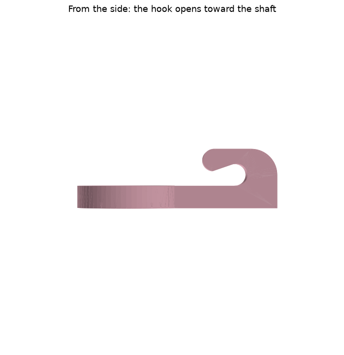

# bekant-net-hook

A hook that gives the IKEA Bekant's cable net slack. The net's loops are too tight on the net
holders under the desk. The hook's eye goes on a holder's shaft, under the holder's ring, and the
net's loop hooks into the other end, 32 mm further out.




## Parts

| Printed | Count | Prints | Supports |
| --- | --- | --- | --- |
| `hook` | 1 | Flat face down, pocket and hook up | Under the hook's top and its tip |

The eye's hole is the holder's 10.55 mm shaft with 0.2 mm a side. The pocket round it is the
holder's 20 mm ring with 0.2 mm a side, and its floor is 1.55 mm thick, the room under the ring.
The eye and the arm are 6 mm thick.

The hook stands on the end of the arm and opens toward the shaft. Its back is straight, in line
with the arm's end, and rounds over at the top. Its top runs toward the shaft and ends in a round
tip that comes down again, which keeps the loop in the hook. The room inside is 6 mm high at its
round back and narrows to a 4 mm mouth under the tip. Its ceiling is a straight line between the
two, so the inside has no corner. The wall over the room is 4 mm at its back and the wall behind
it, at the arm's end, 8 mm. The hook is as wide as the arm, 14 mm.

The hook's top and its tip hang over the arm and print on supports, which the plate turns on for
this piece (`enable_support`). The net pulls the hook along its layers, across the 8 mm wall where
it stands on the arm.

## Putting it together

1. Take the net holder off the desk.
2. Put the holder's shaft through the eye, the ring in the pocket.
3. Put the holder back, with the arm pointing at the net.
4. Slide the net's loop along the arm, through the mouth and into the hook.

## Printing

```sh
bin/part bekant-net-hook --open
```


