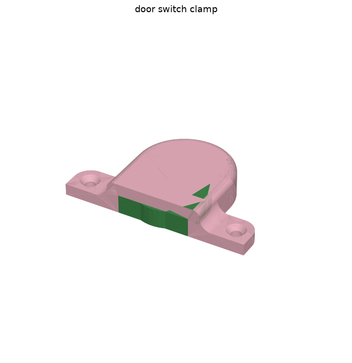
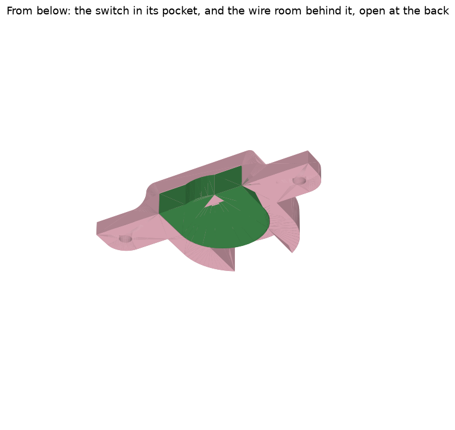
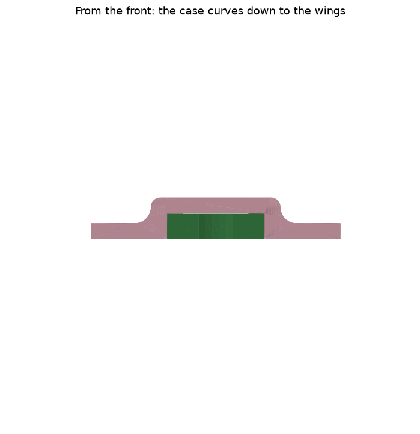
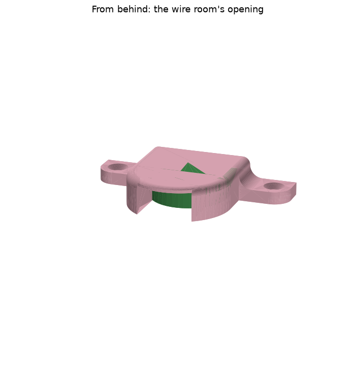
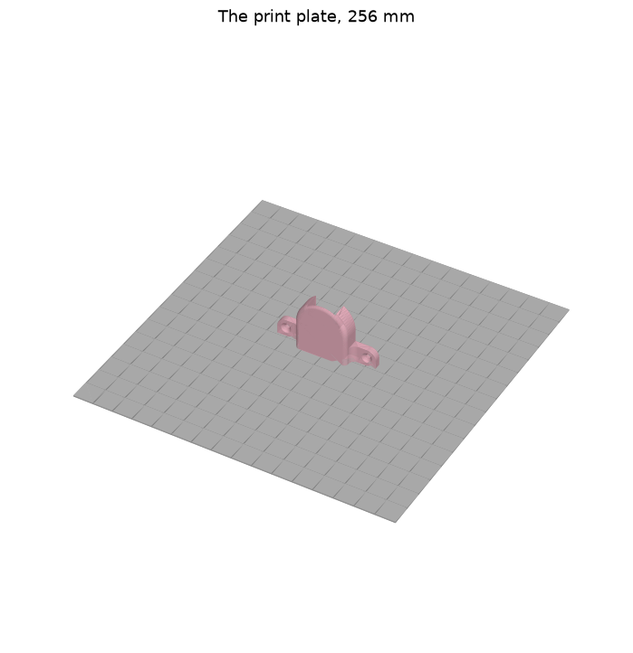

# door-switch-clamp

A clamp that holds the door switch, which turns the light on when the door opens, and covers its
wires. The case goes over the switch and is screwed down through a wing on either side.









## Parts

| Printed | Count | Prints | Supports |
| --- | --- | --- | --- |
| `clamp` | 1 | Standing on its open front | None |

| Bought | Count | Source |
| --- | --- | --- |
| The door switch, 31 × 30 × 8 mm, with a half-round back | 1 | In the house |
| Countersunk chipboard screw, 4 mm, Phillips, 8 mm head (DIN 7997), 16 mm or longer | 2 | Hardware store |

The clamp is 79.8 mm wide, 44.2 mm deep and 13.2 mm high.

The pocket is the switch with 0.2 mm a side and 0.2 mm over it. The switch's front stays open,
flush with the case's front, for the door. The pocket's back is round like the switch's.

The wire room behind the switch is 22.2 mm wide, narrower than the switch, so the pocket's round
back stays as a shoulder on either side. The switch rests against the shoulders when the door
pushes it. The room is 11.2 mm high, 3 mm more than the pocket: its ceiling rises at 45° behind
the switch. The room is open at the back over its whole width and height, 22.2 × 11.2 mm, and the
wires leave through that opening. The case's top covers 14 mm of them behind the switch.

The case's side walls are 5 mm thick, and its top is 5 mm over the switch and 2 mm over the wire
room, where it carries no load. The case is round at the back, like the switch, and the wire
room's opening cuts through that round. Its top rounds over to its sides with a 3 mm radius, and
each side curves down to a wing with a 5.2 mm radius. Over the opening the top ends 1 mm short of
the round's edge, where it is 1.2 mm thick.

The wings are at the front, 5 mm thick and 14 mm deep, and reach 19.2 mm out from the case. Each
has a hole for a 4 mm screw, 7 mm from the front and 32.9 mm from the middle of the case, with a
90° cone seat that takes the 8 mm head flush with the wing's top. The hole's clearance is
`screw_hole` from `printers.toml`. The screws hold 3 mm of wing under their heads.

The clamp stands on its open front when it prints. The pocket's shoulders close in at 45° from
upright, the wire room's ceiling steps back at 45°, and the wire room runs straight up and out of
the top. The screw holes lie on their
sides, 8.3 mm across at their widest. Nothing takes supports. The layers stand along the wings,
so a screw bends its wing along the layers and not across them.

## Putting it together

1. Lay the wires straight back behind the switch, on the surface.
2. Put the clamp over the switch from above, its open front flush with the switch's front and the
   wires in the wire room.
3. Drive a screw down through each wing. Both are reached from above, beside the case.

Taking it off is the same in reverse.

## Printing

```sh
bin/part door-switch-clamp --open
```


