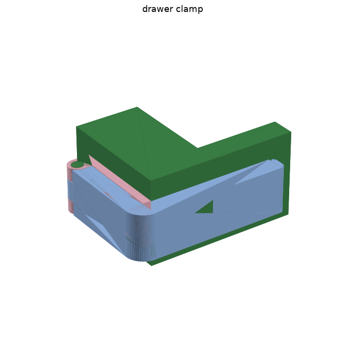
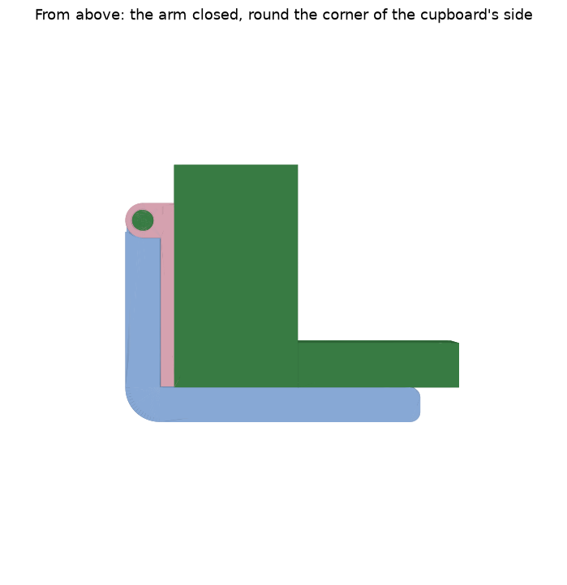
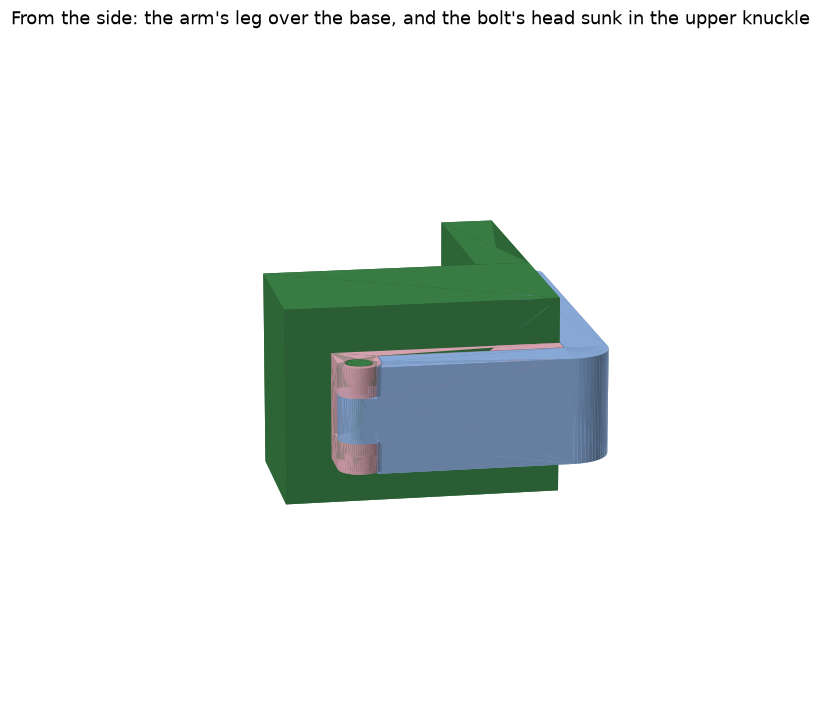
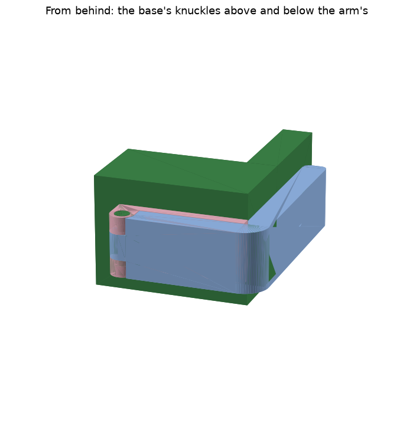
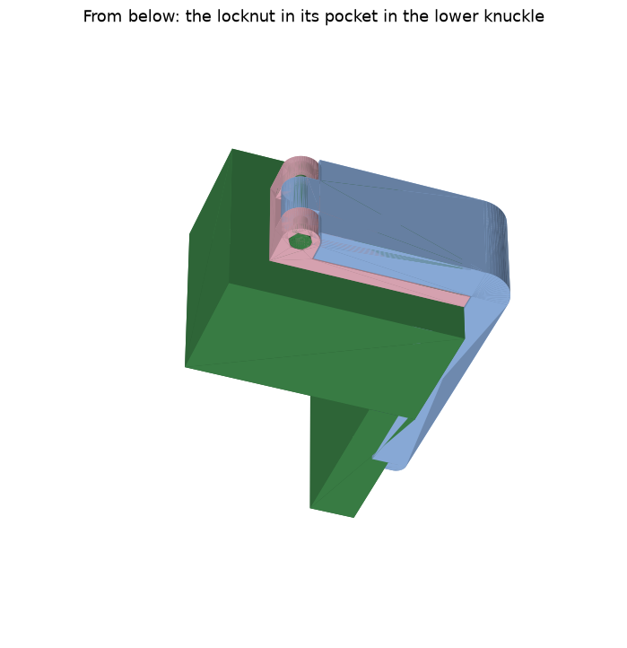
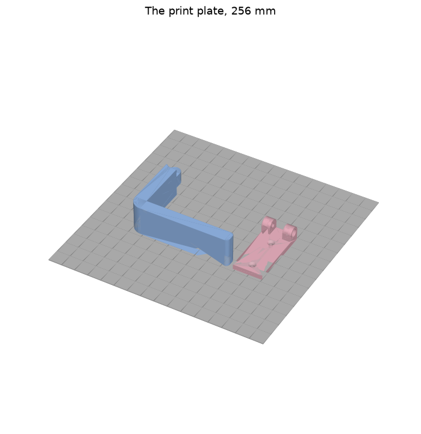

# drawer-clamp

A clamp that keeps a drawer shut. A base is screwed to the outside of the cupboard's side, from
its front edge back. Its plate has a knuckle on it at the top and the bottom of its back, and an M5 bolt
stands upright through both, with its head sunk in the upper one and its locknut in the lower
one, both level with the outside. An arm turns on the bolt, with its knuckle between the base's two.
The arm is an angle, as high as the base: one leg lies along the side, over the base, and the
other goes round the corner and across the drawer's front. It swings out sideways, and the drawer is free.











## Parts

| Printed | Count | Prints | Supports |
| --- | --- | --- | --- |
| `base` | 1 | On its back, the face that lies against the cupboard | None |
| `arm` | 1 | Lying as it sits | Under its knuckle |

| Bought | Count | Source |
| --- | --- | --- |
| M5 × 30 socket cap bolt (ISO 4762), 35 mm long with its head | 1 | In the house |
| M5 locknut (DIN 985) | 1 | Hardware store |
| Countersunk chipboard screw, 4 × 30 mm, 8 mm head (DIN 7997), with 6 mm of its length in the base | 2 | Hardware store |

The cupboard's side is 50 mm thick, and the drawer's front is flush with its front edge.

The base and the arm are both 35 mm high, the bolt's length with its head.

The base is 75 mm long, from the side's front edge back. Its plate against the side is 6 mm
thick and runs the base's whole length and height. A knuckle stands on the plate at the top and
at the bottom of its back end. Each is 10 mm high, 14 mm long and 14.5 mm out from the plate,
square where it stands on the plate and round on the outside. Two screws go through the plate
into the side, 10 and 50 mm behind the front edge and 17.5 mm up, with their heads sunk into
the plate's outside. Each hole is the screw with the `screw_hole` fit from `printers.toml` on
either side.

The bolt stands 13.5 mm outside the cupboard's side and 68 mm behind its front edge. Its hole
is the bolt with the `screw_hole` fit on either side, and the arm turns on it. The head sits in
a round hole in the upper knuckle's top, 9.5 mm across and 5 mm deep, level with the top, with
0.5 mm round it. The locknut sits in a hex pocket in the lower knuckle's underside, 5 mm deep,
the nut with the `nut_pocket` fit on either side: it presses in and does not turn. The nut and
the bolt's end are level with the underside. Under the head and over the nut the knuckle is
5 mm thick.

The arm's legs are 14 mm thick, as thick as its knuckle is across, so the leg's faces run on
from the knuckle's. The knuckle is 14.9 mm high, and sits between
the base's two with 0.05 mm above and below. That is less than a sliding fit: the bolt closes
the base's knuckles onto the arm's, and the arm turns stiffly. The knuckle turns 0.5 mm from the
base's plate. One leg runs forward along the side, 0.5 mm outside the plate, and covers the two
screws. It has its full height up to 0.5 mm before the base's knuckles, and a neck as high as
the arm's knuckle joins the two. On the outside half the leg's end is hollow: it goes on round
the base's knuckles, 0.5 mm from their round side, and stops where it is 1.2 mm thick, 4.8 mm
before the bolt. At the front the leg turns 90° into the other leg, which lies
0.5 mm in front of the side's edge and the drawer's front and ends 100 mm in from the outside of
the side. So 50 mm of it lies on the side's front edge and 50 mm on the drawer's front. The
outside of the corner is round, with a 14 mm radius, and the inside is square. The two upright
corners at the arm's end are round, with a 4 mm radius.

The base prints on its back. The knuckles stand up from the plate, round on top, and the
screws' holes are upright. The bolt's hole, the hole for its head and the nut's pocket lie
level. Their tops bridge 5 mm, 9.5 mm and 5 mm, the pocket's along one of its flats. The base
takes no supports. The knuckles' layers lie across them. The bolt bends each knuckle 0.05 mm at
most before it rests on the arm's knuckle, and from there the bolt presses the three together.

The arm prints lying as it sits. Every layer is the whole angle, so the drawer's push bends the
arm along its layers. Its knuckle and the neck to it hang 10 mm above the plate and print on
supports, which the plate turns on for this piece (`enable_support`).

## Putting it together

1. Hold the base against the outside of the cupboard's side, its knuckles at the back and its
   front end level with the side's front edge, and screw it on with the two 4 mm screws, from the
   outside.
2. Slide the arm's knuckle in between the base's two, from the outside, with the arm swung out.
3. Press the locknut into its pocket in the lower knuckle, from below, its nylon ring down.
4. Push the bolt down through the three knuckles and turn it into the nut with a 4 mm hex key.
5. Tighten the bolt until the arm turns stiffly and stays where it is put.
6. Swing the arm shut, round the corner and across the drawer's front.

To take it off, undo the bolt, slide the arm out and take out the two screws.

## Printing

```sh
bin/part drawer-clamp --open
```


