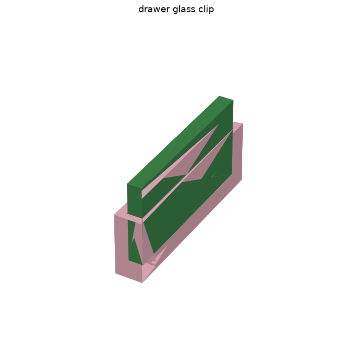
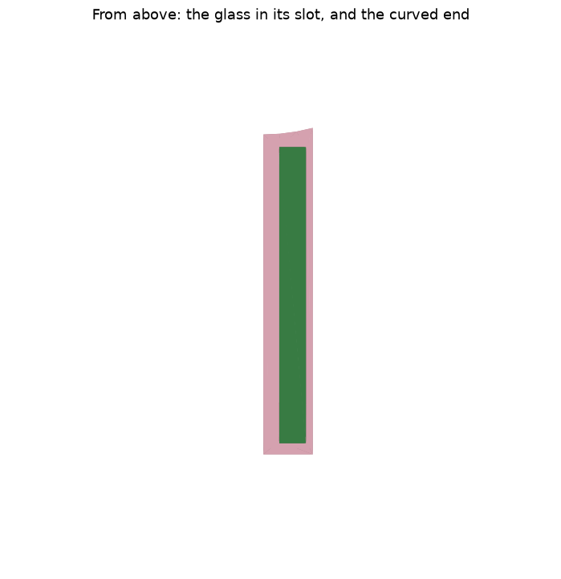
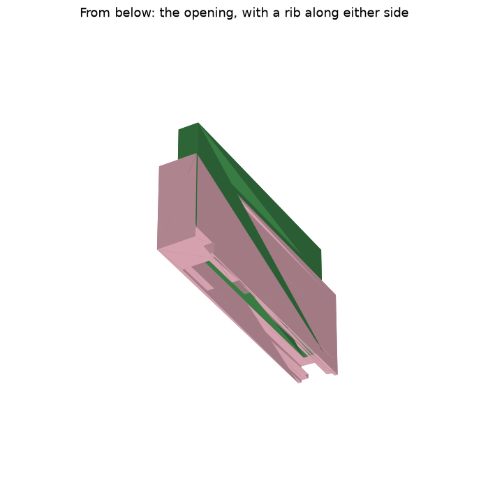
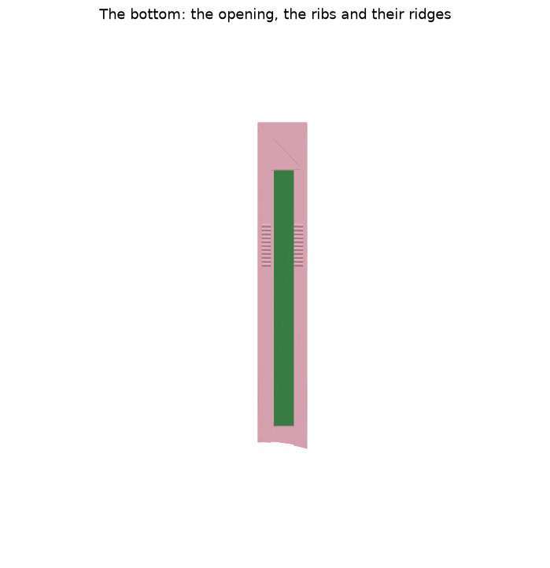
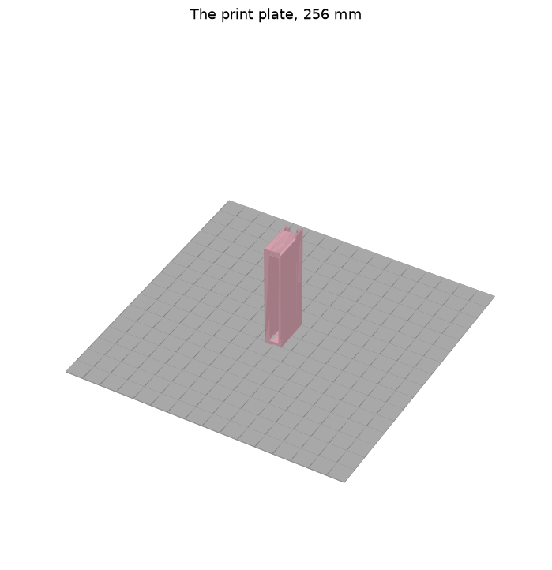

# drawer-glass-clip

A sleeve that connects a plate of glass to the front of a drawer. The glass comes in from the
top, and the drawer's holders slide in at the curved end and grip onto ridged ribs in an opening
in the bottom. It is a draft: some sizes are read off photos of the original.









## Parts

| Printed | Count | Prints | Supports |
| --- | --- | --- | --- |
| `clip` | 1 | Standing on its flat end, with a 5 mm brim | None |

| Bought | Count | Source |
| --- | --- | --- |
| The plate of glass, 8 mm thick, with an 89 mm edge in the slot | 1 | In the house |

The clip is 100 mm long, 15.1 mm wide and 35 mm from bottom to top. The 35 mm is read off a
photo of the original on a cutting mat.

The slot for the glass is open at the top. It is 8.4 mm wide and 89.6 mm long, the glass with
0.2 mm a side and 0.3 mm at each end: the glass slides in and the slot does not grip it. It
starts 2 mm from the clip's long side and 4 mm from the flat end, which is read off a photo. The
wall on its other side is 4.7 mm thick. The slot stops 7 mm above the bottom.

The bottom has an opening for the drawer's holders: 12.7 mm across, between walls 1.2 mm thick,
and open up to the glass. It starts 14.5 mm from the flat end and runs out through the curved
end, where the holders slide in. The original's walls are 1 mm; 1.2 mm is the least this printer
makes a wall.

A rib runs along either side of the opening, over its whole length, near the bottom edge. Each
rib with its wall is 4 mm wide, so the gap between the ribs is 7.1 mm. A rib's underside is 1 mm
above the bottom, and the rib is 1.75 mm thick. Behind it, up to the glass, is 4.25 mm of room
for what grips onto it. Each rib's underside has a patch of ridges: 11 grooves, 0.4 mm deep and
1.2 mm apart, from 31 to 44.2 mm from the flat end, with the ridges' tips level with the
underside. Where the opening starts and where the ridges are along the clip, are read off a
photo.

Before the opening the clip is solid under the glass, and the glass stands on that: on 10.2 mm
at the flat end. Over the opening the slot has no floor.

One end is flat. The other end's face curves across the clip, hollow: it is at 100 mm at the
long side, the side the slot is nearest to, and sweeps back to 98 mm at the other side, an arc
with a 58 mm radius.

The clip stands on its flat end when it prints. Every layer is then a ring or a U round the
glass, so the glass pushes the walls apart along the layers and cannot split them off. The
slot's upper end bridges 8.4 mm, from wall to wall. The ribs stand on the solid end. The
grooves' faces lean 34° from upright. Nothing takes supports. The piece is 100 mm tall on a 15.1 × 35 mm foot, and a brim keeps it on the plate.

## Putting it together

1. Slide the clip onto the drawer's holders, curved end first, so they grip the ribs.
2. Slide the glass's edge down into the slot, onto its floor.

## Printing

```sh
bin/part drawer-glass-clip --open
```


